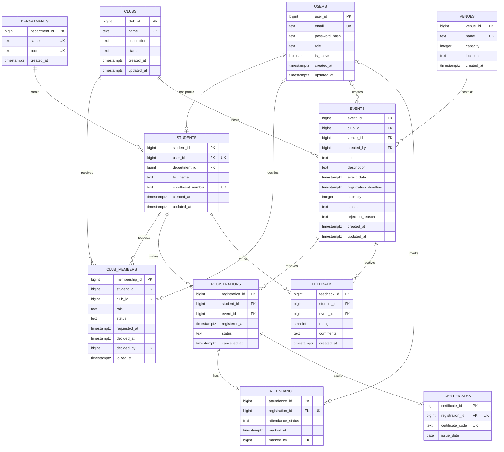

# CampusConnect ER Diagram

This document contains:

1. a Mermaid entity–relationship diagram of the 11 physical tables;
2. a relationship and cardinality table;
3. step-by-step Chen-notation instructions for ERDPlus;
4. the ER → relational mapping rules used by the migrations.

The physical schema is in `backend/migrations/00001_schema.sql`. The conceptual
model has 9 strong entities plus 2 associative entities, which map to exactly the
11 tables.

---

## 1. Mermaid ER diagram (physical schema)

**Reading the cardinality symbols**

| Symbol | Meaning |
|---|---|
| `||--o{` | Exactly one on the left, zero or more on the right |
| `||--o|` | Exactly one on the left, zero or one on the right |
| `|o--o{` | Zero or one on the left, zero or more on the right |

Mermaid does not express composite `UNIQUE` constraints per column, so the
`UK` marker on `(student_id, club_id)` and `(student_id, event_id)` is explained
in the relationship table below. The PK/UK/FK markers are documentation only;
the migration is authoritative.

---

## 2. Relationships and cardinality

| # | Relationship | Entities | Cardinality | Participation | Implementation |
|---:|---|---|---|---|---|
| 1 | Enrols | Department — Student | 1 : N | Department mandatory per student; a department may have zero students | `students.department_id` FK, `RESTRICT` |
| 2 | Has profile | User — Student | 1 : 0..1 | Student requires one user; a user may have no student profile | `students.user_id` UNIQUE FK, `CASCADE` |
| 3 | Requests / receives | Student — ClubMember | 1 : N | A student may request several clubs; a club may have zero members | `club_members.student_id`, `UNIQUE (student_id, club_id)` |
| 4 | Requests / receives | Club — ClubMember | 1 : N | A club has zero or many membership rows | `club_members.club_id`, `ON DELETE CASCADE` |
| 5 | Decides | User — ClubMember | 1 : 0..N | A coordinator/admin decides many requests; a request has zero or one decider | `club_members.decided_by`, nullable, `SET NULL` |
| 6 | Hosts | Club — Event | 1 : N | A club may have zero events; every event has exactly one club | `events.club_id` FK, `RESTRICT` |
| 7 | Occurs at | Venue — Event | 1 : N | A venue may host zero or many events over time; every event has one venue | `events.venue_id` FK, `RESTRICT` |
| 8 | Creates | User — Event | 1 : 0..N | A user creates zero or many events; an event has zero or one creator | `events.created_by`, nullable, `SET NULL` |
| 9 | Makes | Student — Registration | 1 : N | A student may register for zero or many events | `registrations.student_id`, `UNIQUE (student_id, event_id)` |
| 10 | Receives | Event — Registration | 1 : N | An event may have zero or many registrations | `registrations.event_id`, `ON DELETE RESTRICT` |
| 11 | Has attendance | Registration — Attendance | 1 : 0..1 | A registration has zero or one attendance row | `attendance.registration_id` UNIQUE FK |
| 12 | Marks | User — Attendance | 1 : 0..N | A coordinator/admin marks many rows; a mark has zero or one marker | `attendance.marked_by`, nullable, `SET NULL` |
| 13 | Earns | Registration — Certificate | 1 : 0..1 | A registration earns zero or one certificate | `certificates.registration_id` UNIQUE FK |
| 14 | Writes | Student — Feedback | 1 : N | A student may write feedback for many events | `feedback.student_id`, `UNIQUE (student_id, event_id)` |
| 15 | Receives | Event — Feedback | 1 : N | An event may receive zero or many feedback rows | `feedback.event_id`, `ON DELETE RESTRICT` |

The Student–Club and Student–Event many-to-many relationships are resolved by
`club_members` and `registrations`. Attendance and certificates are 1:0..1
extensions of a registration, not of a student/event pair, so a cancelled or
re-registered event attempt keeps one history row per registration.

---

## 3. Chen-notation conversion in ERDPlus

ERDPlus draws Chen notation with **rectangles = entities**, **diamonds =
relationships**, **ovals = attributes**, **underlined attribute = primary key**,
and **1/N labels on relationship edges**. The conceptual model below can be
reproduced directly in ERDPlus and exported as `docs/er-diagram.png` or PDF.

### 3.1 Entities and attributes

Create a rectangle for each entity and attach ovals. Underline the primary key.

| Entity | Attributes (underline = PK) | Notes |
|---|---|---|
| **USERS** | <u>user_id</u>, email, password_hash, role, is_active, created_at, updated_at | Email is an alternate key (dashed underline or note "AK") |
| **DEPARTMENTS** | <u>department_id</u>, name, code, created_at | Name and code are alternate keys |
| **STUDENTS** | <u>student_id</u>, user_id, department_id, full_name, enrollment_number, created_at, updated_at | `user_id` and `enrollment_number` unique |
| **CLUBS** | <u>club_id</u>, name, description, status, created_at, updated_at | Name unique |
| **CLUB_MEMBERS** | <u>membership_id</u>, student_id, club_id, role, status, requested_at, decided_at, decided_by, joined_at | Associative entity (see §3.2) |
| **VENUES** | <u>venue_id</u>, name, capacity, location, created_at | Name unique |
| **EVENTS** | <u>event_id</u>, club_id, venue_id, created_by, title, description, event_date, registration_deadline, capacity, status, rejection_reason, created_at, updated_at | — |
| **REGISTRATIONS** | <u>registration_id</u>, student_id, event_id, registered_at, status, cancelled_at | Associative entity (see §3.2) |
| **ATTENDANCE** | <u>attendance_id</u>, registration_id, attendance_status, marked_at, marked_by | `registration_id` is an alternate key |
| **FEEDBACK** | <u>feedback_id</u>, student_id, event_id, rating, comments, created_at | `(student_id, event_id)` is a composite alternate key |
| **CERTIFICATES** | <u>certificate_id</u>, registration_id, certificate_code, issue_date | `registration_id` and `certificate_code` are alternate keys |

Derived attributes are not stored: `seats_remaining`, `confirmed_registrations`,
`average_rating` and `present_count` are computed by views/functions. Multi-valued
attributes do not exist (no `clubs` array on a student), which is the 1NF
requirement.

### 3.2 Promote `club_members` and `registrations` to associative entities

A strict Chen diagram can show Student–Club and Student–Event as M:N diamonds
named `MEMBERSHIP` and `REGISTRATION`. However:

- `Club_Members` carries its own lifecycle (`requested_at`, `decided_at`,
  `decided_by`, `joined_at`, `role`, `status`) and is queried directly;
- `Registrations` is the parent of `Attendance` and `Certificates`, and a
  relationship diamond cannot be the parent of another relationship.

For those reasons, draw **CLUB_MEMBERS** and **REGISTRATIONS** as associative
entities: rectangles (optionally with a double border) connected to their two
parents by 1:N diamonds. This keeps the conceptual diagram consistent with the
11-table relational schema and avoids a diamond with incoming relationships.

### 3.3 Relationship diamonds

Draw a diamond on each edge and label the cardinality at both ends.

| Diamond | Connects | Left label | Right label | Participation |
|---|---|---|---|---|
| `ENROLLS` | DEPARTMENTS — STUDENTS | 1 | N | Student total participation |
| `HAS_PROFILE` | USERS — STUDENTS | 1 | 0..1 | Student total; user partial |
| `REQUESTS` | STUDENTS — CLUB_MEMBERS | 1 | N | Club_Member total |
| `ROSTERS` | CLUBS — CLUB_MEMBERS | 1 | N | Club_Member total |
| `DECIDES` | USERS — CLUB_MEMBERS | 1 | 0..N | Optional decider |
| `HOSTS` | CLUBS — EVENTS | 1 | N | Event total |
| `OCCURS_AT` | VENUES — EVENTS | 1 | N | Event total |
| `CREATES` | USERS — EVENTS | 1 | 0..N | Optional creator |
| `MAKES` | STUDENTS — REGISTRATIONS | 1 | N | Registration total |
| `FOR_EVENT` | EVENTS — REGISTRATIONS | 1 | N | Registration total |
| `RECORDS` | REGISTRATIONS — ATTENDANCE | 1 | 0..1 | Optional attendance |
| `MARKS` | USERS — ATTENDANCE | 1 | 0..N | Optional marker |
| `EARNS` | REGISTRATIONS — CERTIFICATES | 1 | 0..1 | Optional certificate |
| `WRITES` | STUDENTS — FEEDBACK | 1 | N | Feedback total |
| `ABOUT` | EVENTS — FEEDBACK | 1 | N | Feedback total |

Use "1" on the parent side and "N" (or "0..1") on the child side. For optional
relationships, write `0..1` or `0..N` on the optional end and shade the
participation line if ERDPlus supports it.

### 3.4 ERDPlus steps

1. Open ERDPlus → **Create → ER Diagram**.
2. Add the 9 strong entity rectangles: USERS, DEPARTMENTS, STUDENTS, CLUBS,
   VENUES, EVENTS, ATTENDANCE, FEEDBACK, CERTIFICATES.
3. Add the 2 associative entity rectangles: CLUB_MEMBERS, REGISTRATIONS. Place
   REGISTRATIONS between STUDENTS and EVENTS, and CLUB_MEMBERS between STUDENTS
   and CLUBS.
4. Add attributes as ovals. Underline `user_id`, `department_id`, `student_id`,
   `club_id`, `membership_id`, `venue_id`, `event_id`, `registration_id`,
   `attendance_id`, `feedback_id`, `certificate_id`.
5. Add the relationship diamonds from §3.3 with "1" and "N"/"0..1" labels.
6. Connect each diamond to exactly the two entity rectangles it relates.
   `DECIDES`, `CREATES` and `MARKS` connect USERS to the optional foreign-key
   side; keep them visually separate from the main flow.
7. Add a text note: "club_members UNIQUE(student_id, club_id); registrations
   UNIQUE(student_id, event_id); attendance and certificates UNIQUE(registration_id);
   feedback UNIQUE(student_id, event_id)".
8. Validate: every child entity has one parent on its "1" side; no attribute is
   multi-valued; no relationship has an attribute that depends on only one
   parent.
9. Export as PNG (`docs/er-diagram.png`) and PDF (`docs/relational-schema.pdf`).
   The markdown Mermaid diagram above is the version-controlled textual source.

### 3.5 Optional simplified M:N version

If the evaluator requires strict Chen notation with diamonds for the two M:N
relationships, draw `MEMBERSHIP` (STUDENT–CLUB) and `REGISTRATION`
(STUDENT–EVENT) as diamonds with their own attributes attached. Then add a note
that each M:N relationship maps to a junction table, and that `ATTENDANCE` and
`CERTIFICATES` reference the `REGISTRATION` table produced by that mapping. The
Mermaid diagram in §1 remains the implementation view.

---

## 4. ER → relational schema mapping

| ER construct | Relational rule | CampusConnect application |
|---|---|---|
| Strong entity | Table; simple attribute → column; underlined key → PRIMARY KEY | `users`, `departments`, `clubs`, `venues`, `events`, `feedback`, `attendance`, `certificates` |
| 1:1 relationship | Foreign key on the optional side with UNIQUE | `students.user_id` UNIQUE (User 1:0..1 Student) |
| 1:N relationship | Foreign key on the N side referencing the 1 side | `students.department_id`, `events.club_id`, `events.venue_id`, `club_members.student_id`, `registrations.event_id`, `feedback.event_id` |
| M:N relationship | Junction table with FKs to both parents and a composite UNIQUE | `club_members(student_id, club_id)`, `registrations(student_id, event_id)` |
| Relationship attribute | Column on the junction/relationship table | `club_members.role/status/requested_at/...`, `registrations.status/registered_at/cancelled_at` |
| Multi-valued attribute | Separate table + FK (1:N) | None needed — no multi-valued attributes |
| Derived attribute | Computed in a view/function, not stored | `seats_remaining`, counts, averages |
| Optional participation | Nullable FK | `events.created_by`, `club_members.decided_by`, `attendance.marked_by` |
| Total participation | NOT NULL FK | `registrations.student_id`, `registrations.event_id`, `events.club_id`, `events.venue_id` |
| Weak/associative entity | Table with its own surrogate PK and a composite UNIQUE | `club_members`, `registrations` |

The resulting 11 relations are in 3NF: every non-key attribute depends on the
whole key and nothing but the key (the detailed functional-dependency argument
is in `docs/project-report.md`, §6).
